<div align="center">


[](https://www.linkedin.com/in/sarthakviche/)
[](https://sarthakviche.carrd.co/)

<a href="https://github.com/sarthakviche">
  
</a>

</div>

## 🎯 About Me

I'm a student in Pune who builds AI products end to end: the model, the backend, the interface, and the part where real people actually use it. My work sits where machine learning meets Indian finance and regulation.

<table>
<tr>
<td width="33%" valign="top">

**📈 Markets**<br>
Research and practice tools for Indian equities, built to teach rather than tip.

</td>
<td width="33%" valign="top">

**⚖️ Compliance**<br>
GST workflows and SEBI circulars turned into structured, checkable output.

</td>
<td width="33%" valign="top">

**🔬 Applied ML**<br>
Computer vision and explainable models, from training to dashboard.

</td>
</tr>
</table>

## 🔥 Featured Work

<div align="center">

<a href="https://github.com/sarthakviche/belfort"></a>
<a href="https://github.com/sarthakviche/m1m-business-workflow-agent"></a>
<a href="https://github.com/sarthakviche/AutoYeildAI"></a>
<a href="https://github.com/sarthakviche/SERA-Securities-Engine-for-Regulatory-Action"></a>

</div>

## 🛠️ Tech Stack

<div align="center">


</div>

## 🚀 Now

```console
sarthak@pune:~$ cat now.txt
> shipping Belfort and Munim to more users
> building agent workflows that run unattended
> getting better at systems, not just models
```


